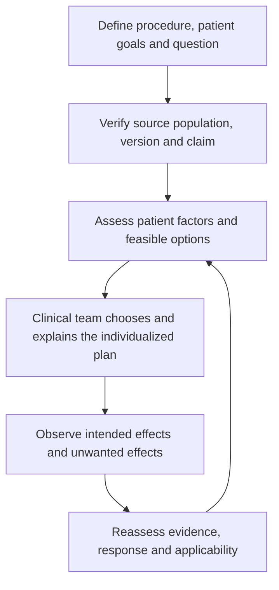

# Opioid-sparing anesthesia: applied cases

28 October 2026. Educational source application only. This supplement does not restore the earlier manuscript or publish another Zenodo version.

All examples are entirely synthetic, independent of real encounters, charts or shadowing observations. They illustrate source-informed reasoning, not observed administrations, validated treatment plans, standardized drug regimens or clinical competence. Male/female labels are descriptive; any difference in the discussion follows history, procedure and evidence applicability rather than sex alone. Female cases are nonpregnant unless explicitly stated otherwise.

## Shared example set and method

Read [the local anesthesia-options case set](ANESTHESIA_OPTIONS_AND_CASES.md) for the same four-modality comparison, 12 general teaching cases, medication roles/routes, monitoring distinctions and decision flows used throughout this portfolio. The topic-specific pairs below apply that format to this repository.

Standardize the reasoning: identify the clinical question → verify source/version and population → distinguish published recommendation from fictional inference → assess patient-specific alternatives and monitoring → reassess effects and harms. A DOI establishes an identifier, not the truth or clinical suitability of every inferred decision. Source verification here covers identities and available abstracts/selected passages; it is not an exhaustive full-text systematic appraisal.

## NOA-01 — Define opioid-free phase versus multimodal care

- **Synthetic male example:** 48-year-old male, 180 cm, 82 kg, elective abdominal surgery with no stated organ dysfunction.
- **Synthetic female example:** 48-year-old female, 164 cm, 64 kg, same procedure with prior unpleasant opioid effects.

**Worked application:** Agree which phase is being discussed and what outcomes matter. Prior adverse effects inform choice but do not prove that every opioid-free strategy is safer.

**Options / medication and administration context:** IV or inhaled general anesthesia, suitable local/regional analgesia and selected systemic agents may be considered; rescue analgesia remains a clinical option.

**Decision flow:** Define goals and phase → compare evidence/population → select suitable components → assess harms and recovery.

**Source map:** [P](#source-registry), [B](#source-registry), [T](#source-registry). The sources support the named concepts, not the existence or validation of these fictional administrations.

## NOA-02 — Dexmedetomidine and patient risk

- **Synthetic male example:** 77-year-old male, 179 cm, 80 kg, bradycardia and conduction history.
- **Synthetic female example:** 77-year-old female, 163 cm, 63 kg, hypotension risk and impaired hepatic function.

**Worked application:** A literature dose range does not establish suitability or support a universal age-based reduction. These fictional risks warrant reassessment before any alpha-2 agonist plan.

**Options / medication and administration context:** A dexmedetomidine adjunct is not necessary for every multimodal anesthetic; other suitable approaches depend on the clinical goals.

**Decision flow:** Identify risk and indication → assess alternatives → determine monitoring → reassess.

**Source map:** [DEX](#source-registry), [P](#source-registry). The sources support the named concepts, not the existence or validation of these fictional administrations.

## NOA-03 — Lidocaine route and exposure

- **Synthetic male example:** 51-year-old male, 180 cm, 81 kg, an IV lidocaine option is being discussed.
- **Synthetic female example:** 51-year-old female, 164 cm, 65 kg, a peripheral block and infiltration are already planned.

**Worked application:** Review exact routes, preparations and timing; the lidocaine consensus does not support assuming concurrent local-anesthetic exposure is safe merely after arithmetic.

**Options / medication and administration context:** Consider the IV option separately from a regional/local plan; the examples do not choose a loading dose or pump setting.

**Decision flow:** Inventory exposures → check overlap limits → select compatible approach → monitor.

**Source map:** [LIDO](#source-registry), [X](#source-registry). The sources support the named concepts, not the existence or validation of these fictional administrations.

## NOA-04 — Ketamine purpose and clinical assessment

- **Synthetic male example:** 44-year-old male, 181 cm, 84 kg, persistent procedural pain is the discussion topic.
- **Synthetic female example:** 44-year-old female, 165 cm, 65 kg, anxiety is the main concern and analgesia appears adequate.

**Worked application:** Analgesic-adjunct, anxiolytic and hypnotic goals are different. A ketamine acute-pain source cannot by itself justify sedation or induction decisions.

**Options / medication and administration context:** Selected acute-pain adjuncts require indication and adverse-effect review; anxiety does not automatically call for an analgesic infusion.

**Decision flow:** Identify the unmet goal → assess relevant evidence → compare options → monitor response.

**Source map:** [KET](#source-registry), [S](#source-registry). The sources support the named concepts, not the existence or validation of these fictional administrations.

## NOA-05 — Recovery benefits and evidence claims

- **Synthetic male example:** 62-year-old male, 178 cm, 79 kg, lower opioid use with more drowsiness.
- **Synthetic female example:** 62-year-old female, 162 cm, 62 kg, some rescue opioid use with better perceived comfort.

**Worked application:** Reduced opioid exposure is not identical to improved overall recovery. A fictional pair cannot estimate an effect size, prove superiority or validate the manuscript.

**Options / medication and administration context:** Discuss pain/function/adverse effects together; rescue administration need not mean the initial strategy failed.

**Decision flow:** Specify outcomes and time → compare benefits/harms → reassess priorities → document uncertainty.

**Source map:** [P](#source-registry), [QOR](#source-registry). The sources support the named concepts, not the existence or validation of these fictional administrations.

## Source registry and applicability

| ID | DOI source | Scope / limitation |
|---|---|---|
| P | Beloeil H et al. Balanced Opioid-free Anesthesia with Dexmedetomidine versus Balanced Anesthesia with Remifentanil. *Anesthesiology*. 2021. [10.1097/ALN.0000000000003725](https://doi.org/10.1097/ALN.0000000000003725) — [DOI](https://doi.org/10.1097/ALN.0000000000003725) | Randomized evidence against assuming universal safety benefit from avoiding intraoperative opioids; did not test this software |
| B | Joshi GP et al. 2026 ASA Practice Guideline on Perioperative Pain Management Using Local and Regional Analgesia for Cardiothoracic Surgeries, Mastectomy, and Abdominal Surgeries. *Anesthesiology*. [10.1097/ALN.0000000000005790](https://doi.org/10.1097/ALN.0000000000005790) — [DOI](https://doi.org/10.1097/ALN.0000000000005790) | Procedure-specific local/regional adjunct recommendations; not sole-anesthetic selection |
| T | Nimmo AF et al. Guidelines for the safe practice of total intravenous anaesthesia (TIVA). *Anaesthesia*. 2019. [10.1111/anae.14428](https://doi.org/10.1111/anae.14428) — [DOI](https://doi.org/10.1111/anae.14428) | IV delivery and monitoring principles; no validation of Smart NOA |
| DEX | Weerink et al. Dexmedetomidine pharmacology review (2017) — [DOI](https://doi.org/10.1007/s40262-017-0507-7) | Dose contexts differ by indication; toy-model values are not validated by this review. |
| LIDO | Foo et al. IV lidocaine consensus (2021) — [DOI](https://doi.org/10.1111/anae.15270) | High-risk IV use, ideal-body-weight context and avoidance of overlapping local-anesthetic interventions; not a complete regimen. |
| X | Neal JM, Neal EJ, Weinberg GL. ASRA Local Anesthetic Systemic Toxicity checklist: 2020 version. *Regional Anesthesia and Pain Medicine*. 2021. [10.1136/rapm-2020-101986](https://doi.org/10.1136/rapm-2020-101986) — [DOI](https://doi.org/10.1136/rapm-2020-101986) | Published toxicity response resource, not reproduced or replaced by this guide |
| KET | Schwenk et al. Acute-pain ketamine consensus (2018) — [DOI](https://doi.org/10.1097/AAP.0000000000000806) | Acute-pain adjunct context, not hypnosis or universal induction guidance. |
| S | ASA and collaborating societies. Practice Guidelines for Moderate Procedural Sedation and Analgesia 2018. *Anesthesiology*. [10.1097/ALN.0000000000002043](https://doi.org/10.1097/ALN.0000000000002043) — [DOI](https://doi.org/10.1097/ALN.0000000000002043) | Moderate-sedation assessment, monitoring and rescue context; not a deep-sedation recipe |
| QOR | Stark et al. Development and psychometric evaluation of the QoR-15 (2013) — [DOI](https://doi.org/10.1097/ALN.0b013e318289b84b) | Recovery is multidimensional; do not reproduce the questionnaire or interpret a synthetic score as validation. |

[Machine-readable source and case map](EXAMPLE_SOURCE_AUDIT.json). Journal sources have DOI identities checked against publisher/PubMed records or the existing verified portfolio audit. Consensus, narrative reviews, guidelines and trials are different evidence types. Official standards and prescribing information in the shared guide are separately labeled and are not assigned invented DOIs. No questionnaire, society algorithm or proprietary figure is reproduced.

## Administration and dosing boundary

These incomplete profiles do not select an individual dose, block injection, reversal dose or pump setting. Source dose context and transparent arithmetic are available in the shared guide and its linked Smart NOA walkthrough; clinical route, preparation, weight metric, organ function and monitoring determine applicability. The absence of a contraindication in a short case is not clinical clearance. A lower opioid amount or one improved measurement is not a complete recovery benefit.
